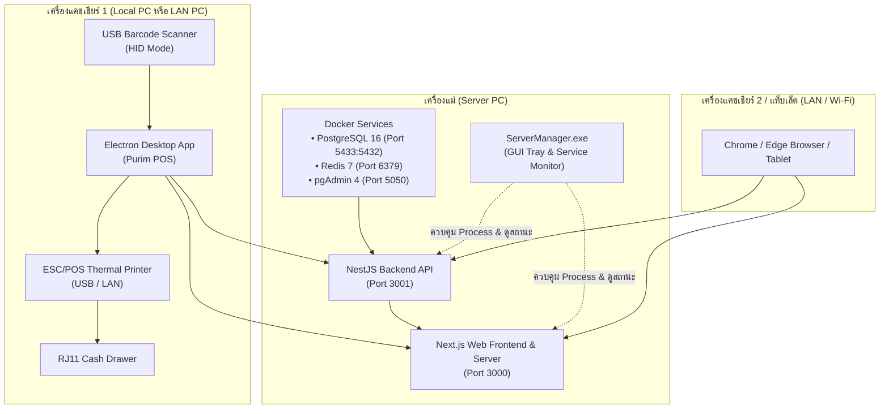

# 01 — สถาปัตยกรรมระบบ (System Architecture)

> เอกสารนี้อธิบายภาพรวมของระบบ Topology เครือข่าย การแบ่งโครงสร้างโฟลเดอร์ และเทคโนโลยีที่ใช้ เพื่อให้ Agent สามารถเข้าใจบริบททั้งหมดก่อนเริ่มเขียนโค้ด

---

## 1. ภาพรวมสถาปัตยกรรมระบบ (High-Level Topology)

ระบบ Purim POS ถูกออกแบบมาสำหรับร้านค้าปลีก/ค้าส่ง (Retail & Wholesale) ที่มีทั้ง **จุดขายหน้าร้านหลายเครื่อง (Multi-Terminal POS)** และ **ระบบจัดการหลังบ้าน (Back-Office Dashboard)** ทำงานร่วมกันบนระบบเครือข่ายภายในร้าน (Local Area Network - LAN) โดยมีสถาปัตยกรรมแบบ Client-Server:



---

## 2. โครงสร้าง Monorepo

```
d:\โปรเจค POS ร้านปุริม/
├── backend/                      # NestJS REST API Server
│   ├── prisma/                   # Prisma Schema, Migrations, Seeders
│   │   ├── schema.prisma         # Single Source of Truth สำหรับ Database
│   │   └── migrations/           # ประวัติการ migrate ฐานข้อมูล
│   ├── src/
│   │   ├── auth/                 # ระบบยืนยันตัวตน, JWT, Role Guard
│   │   ├── products/             # จัดการสินค้า, บาร์โค้ด, หน่วยบรรจุ, ภาพ, ราคาส่ง
│   │   ├── orders/               # บันทึกบิลขาย, Void, Refund, Payments
│   │   ├── shifts/               # กะแคชเชียร์, ตรวจนับเงิน, Cash Movements
│   │   ├── inventory/            # สต็อก, Stock Batches (FIFO), บันทึกเคลื่อนไหว
│   │   ├── customers/            # ข้อมูลลูกค้า, แต้มสะสม, ประวัติการซื้อ
│   │   ├── debts/                # ลูกหนี้การค้า, ชำระหนี้, วงเงินเชื่อ
│   │   ├── suppliers/            # ข้อมูลผู้จัดจำหน่าย/คู่ค้า
│   │   ├── purchase-orders/      # ใบสั่งซื้อ (PO), การรับสินค้าเข้าคลัง
│   │   ├── claims/               # เคลมสินค้าลูกค้า (เปลี่ยน/คืน/ส่งซ่อม)
│   │   ├── supplier-returns/     # คืนสินค้าให้ซัพพลายเออร์, ใบลดหนี้
│   │   ├── bank-accounts/        # บัญชีธนาคารสำหรับรับโอน/PromptPay
│   │   ├── settings/             # ข้อมูลร้าน, หัวบิล, อัตรา VAT, เครื่องพิมพ์
│   │   ├── reports/              # รายงานสรุปยอดขาย, กำไร, สต็อกคงเหลือ
│   │   └── main.ts               # จุดเริ่มต้น NestJS bootstrap
│   └── package.json
│
├── frontend/                     # Next.js App Router (POS + Dashboard)
│   ├── src/
│   │   ├── app/
│   │   │   ├── (main)/           # หน้าจอจัดการหลังบ้าน (Dashboard, สินค้า, สต็อก, ฯลฯ)
│   │   │   ├── pos/              # หน้าจอขายหน้าร้านสำหรับแคชเชียร์ (Full Keyboard & Touch)
│   │   │   ├── login/            # หน้าเข้าสู่ระบบ
│   │   │   └── master-control/   # หน้าจอควบคุม Server สำหรับแอดมิน
│   │   ├── components/           # UI Components (Shadcn/UI, Dialogs, Tables)
│   │   └── lib/
│   │       ├── store/            # Zustand Stores (cart, shift, product, auth)
│   │       ├── api.ts            # Client-side API fetcher พร้อม JWT interceptor
│   │       ├── cart-pricing.ts   # Smart Rollup คำนวณราคา & โปรโมชั่น & ราคาส่ง
│   │       ├── cash-drawer-service.ts # สั่งเปิดลิ้นชักผ่าน IPC หรือ Win32
│   │       ├── thai-barcode-converter.ts # แปลงคีย์บอร์ดไทย -> บาร์โค้ดสากล
│   │       └── offline-db.ts     # IndexedDB สำหรับบันทึกบิลตอนเน็ตหลุด
│   └── package.json
│
├── desktop/                      # Electron Native Wrapper สำหรับ Windows
│   ├── main.js                   # Main Process, สแกนค้นหา IP เครื่องแม่ในวง LAN, จัดการปริ้นเตอร์ & Win32 API
│   ├── preload.js                # Context Bridge ให้เว็บเรียก hardware ได้ปลอดภัย
│   ├── connect-server.html       # หน้าจอค้นหา/เชื่อมต่อเซิร์ฟเวอร์อัตโนมัติ
│   ├── KickDrawer.cs             # C# Native Console ตัวส่ง raw pulse เข้าพอร์ตปริ้นเตอร์
│   ├── kick-drawer.exe           # ไบนารีคอมไพล์แล้วสำหรับเตะลิ้นชักความเร็วสูง
│   └── package.json              # electron-builder config (NSIS & Portable)
│
├── Installer/                    # ชุดโปรแกรมติดตั้งสำเร็จรูปสำหรับร้านค้า
│   ├── Client/                   # ติดตั้งบนเครื่องลูก (Purim POS Setup.exe, Portable)
│   └── Server/                   # ติดตั้งบนเครื่องแม่ (ServerManager GUI, Docker configs)
│
├── docker-compose.yml            # PostgreSQL 16 + Redis 7 + pgAdmin 4
├── start-server.js               # สคริปต์ตรวจจับ IP LAN และสตาร์ททั้ง Backend + Frontend
└── START_SERVER.bat              # Batch file คลิกเดียวเปิดระบบสำหรับผู้ใช้ทั่วไป
```

---

## 3. รายละเอียดเทคโนโลยี (Tech Stack)

### 3.1 Backend
- **Framework**: NestJS 11 (Node.js runtime บน TypeScript)
- **ORM**: Prisma 6.19
- **Database**: PostgreSQL 16 (รันผ่าน Docker Compose บนพอร์ต `5433`)
- **Cache & Queue**: Redis 7 Alpine
- **Auth**: Passport-JWT + Bcrypt.js (Access Token แบบ Bearer Token)
- **Validation**: Class-Validator & Class-Transformer

### 3.2 Frontend
- **Framework**: Next.js 16 (React 19) ด้วย App Router
- **State Management**: Zustand 5 (Cart Store, Shift Store, Product Store, Auth Store)
- **Styling**: Tailwind CSS v4, Lucide Icons, Tw-Animate-CSS
- **Data Fetching & Cache**: TanStack React Query v5
- **Barcode & Printing**: JsBarcode (Code128 / EAN13), jsPDF + html2canvas สำหรับพิมพ์เอกสาร A4/สลิป 80mm

### 3.3 Desktop Client & Hardware Integration
- **Shell**: Electron 33
- **Packager**: Electron-Builder 25 (รองรับทั้งตัวติดตั้ง NSIS และ Portable EXE)
- **Low-Level Native Calls**: C# (.NET Framework) + Win32 API `winspool.Drv` สำหรับส่ง ESC/POS byte sequence เข้าเครื่องพิมพ์แบบ Raw Print Spooler โดยตรง

---

## 4. กลไกการเชื่อมต่อเครือข่าย LAN อัตโนมัติ (Zero-Config LAN Discovery)

หนึ่งในจุดแข็งของระบบนี้คือ **เครื่องลูก (Client) สามารถค้นหาเครื่องแม่ (Server) ได้เองโดยไม่ต้องจำ IP**:

1. เมื่อเปิด `start-server.js` บนเครื่องแม่:
   - สคริปต์จะค้นหา IPv4 การ์ดแลนจริง (ตัด WSL, VirtualBox, Bluetooth Adapter ทิ้ง)
   - สตาร์ท Backend บนพอร์ต `3001` และ Frontend บนพอร์ต `3000` โดย Bind IP `0.0.0.0`
2. เมื่อเปิด Electron บนเครื่องลูก:
   - ตรวจสอบ `http://localhost:3000` ก่อน (กรณีเป็นเครื่องเดี่ยว Standalone)
   - หากไม่พบ จะดึง Subnet IP ของเครื่องลูก (เช่น `192.168.1.xxx`) แล้วยิง HTTP probe ไปยังพอร์ต `3000` ทุก IP ใน Subnet `/24` แบบขนาน (Batches ละ 30 IPs)
   - เมื่อเจอเครื่องแม่ที่มี Route `/pos` ตอบกลับมาภายในเวลาไม่เกิน 400ms จะบันทึก IP ลงใน UserData Config และเปลี่ยนเส้นทางเข้าสู่หน้าจอ POS ทันที

---

## 5. โมเดลสิทธิ์การใช้งาน (Role-Based Access Control - RBAC)

ระบบกำหนดบทบาทของผู้ใช้ (User Role) ไว้ 4 ระดับ:

| Role | สิทธิ์การเข้าถึง |
| :--- | :--- |
| **`ADMIN`** | เข้าถึงได้ทุกฟังก์ชัน: แก้ไขราคา, จัดการสต็อก, ตั้งค่าร้านค้า, ลบประวัติ, จัดการผู้ใช้, ดูรายงานกำไร |
| **`MANAGER`** | เปิด-ปิดกะ, อนุมัติการยกเลิกบิล (Void Order), สั่งซื้อสินค้า (PO), จัดการสต็อก, ดูรายงานยอดขายประจำวัน |
| **`CASHIER`** | ขายหน้าร้าน (POS), เปิด-ปิดกะของตนเอง, ดูยอดขายกะตัวเอง, ไม่สามารถลบสินค้าหรือดูต้นทุน/กำไรได้ |
| **`WAREHOUSE`** | รับสินค้าเข้าคลัง, ตรวจนับสต็อก, จัดการการเคลมสินค้าและส่งคืนซัพพลายเออร์ |
