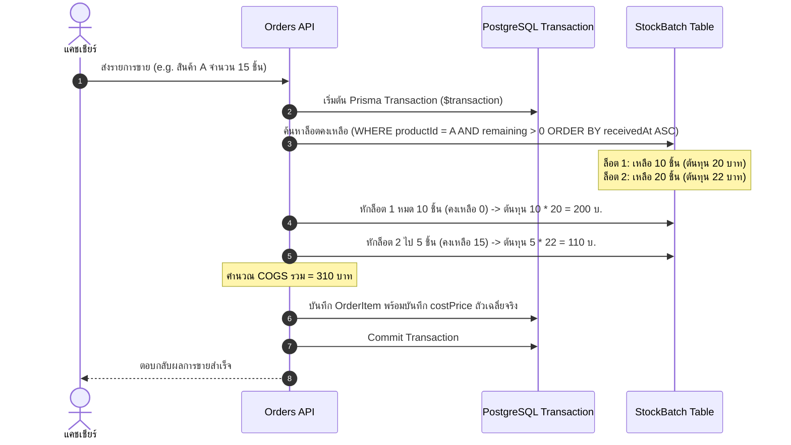
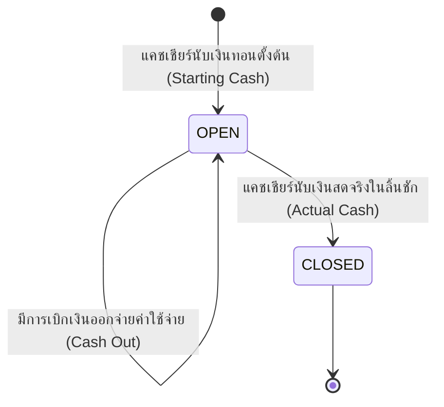

# 06 — ตรรกะทางธุรกิจและอัลกอริทึม (Core Business Logic)

> เอกสารนี้อธิบายอัลกอริทึมสำคัญที่เป็นหัวใจของระบบ Purim POS: Smart Rollup หน่วยสินค้า, การตัดสต็อกแบบ FIFO, การคำนวณเงินสดรอบกะ, และวงจรชีวิตการเคลมสินค้า

---

## 1. อัลกอริทึม Smart Rollup & ตัวคำนวณราคาสินค้า (Smart Rollup & Pricing)

### 1.1 แนวคิด (Concept)
ในร้านค้าปลีก/ส่ง ลูกค้าอาจหยิบสินค้าเป็น "ขวด" มา 12 ขวด หรือแคชเชียร์ยิงบาร์โค้ดขวด 12 ครั้ง แต่ทางร้านมีราคาพิเศษเมื่อซื้อเป็น "แพ็ค 12" หรือมี "ราคาส่งเมื่อซื้อครบ 12 ชิ้นขึ้นไป"

ระบบ Purim POS มีฟังก์ชัน `calculateSmartRollupAndPricing()` คอยตรวจจับจำนวนรวม (Total Base Quantity) ของสินค้าแต่ละตัวในตะกร้า แล้วปรับหน่วยหรือราคาให้เป็นผลประโยชน์สูงสุดแก่ลูกค้าโดยอัตโนมัติ

### 1.2 โค้ดอัลกอริทึม Smart Rollup
```typescript
// frontend/src/lib/cart-pricing.ts
export function calculateSmartRollupAndPricing(items: CartItem[]): CartItem[] {
  if (!items || items.length === 0) return [];

  const productGroups: Record<string, CartItem[]> = {};
  const customOverrideItems: CartItem[] = [];

  // 1. แยกรายการที่แคชเชียร์ลดราคาเอง หรือแก้ไขราคาพิเศษไว้แล้ว ไม่ต้องไปแตะ
  for (const item of items) {
    if (item.customPrice !== null || item.discountType !== 'none') {
      customOverrideItems.push(item);
    } else {
      if (!productGroups[item.productId]) productGroups[item.productId] = [];
      productGroups[item.productId].push(item);
    }
  }

  const resultItems: CartItem[] = [...customOverrideItems];

  // 2. ประมวลผลกลุ่มสินค้าแต่ละชนิด
  for (const productId of Object.keys(productGroups)) {
    const group = productGroups[productId];
    const totalBaseQty = group.reduce(
      (sum, i) => sum + i.quantity * (i.conversionFactor || 1), 
      0
    );

    const packagingUnits = getProductPackagingUnits(productId); // เรียงจากหน่วยใหญ่ไปเล็ก (เช่น ลัง -> แพ็ค)
    const wholesaleSteps = getProductWholesaleSteps(productId);   // เรียงจาก minQuantity มากไปน้อย

    // 2.1 ตรวจสอบขั้นบันไดราคาส่ง (Wholesale Steps)
    let appliedWholesalePrice: number | null = null;
    for (const step of wholesaleSteps) {
      if (totalBaseQty >= step.minQuantity) {
        appliedWholesalePrice = step.unitPrice;
        break;
      }
    }

    if (appliedWholesalePrice !== null) {
      // ได้ราคาส่งตามจำนวนชิ้นฐาน
      resultItems.push({
        ...group[0],
        quantity: totalBaseQty,
        conversionFactor: 1,
        unitPrice: appliedWholesalePrice,
        totalPrice: totalBaseQty * appliedWholesalePrice,
      });
      continue;
    }

    // 2.2 ทำ Rollup ทอนเป็นหน่วยใหญ่ (เช่น 26 ขวด -> 2 แพ็ค [24 ขวด] + 2 ขวดเดี่ยว)
    let remainingBase = totalBaseQty;
    const sortedUnits = [...packagingUnits].sort((a, b) => b.multiplier - a.multiplier);

    for (const unit of sortedUnits) {
      if (unit.multiplier > 1 && remainingBase >= unit.multiplier) {
        const unitCount = Math.floor(remainingBase / unit.multiplier);
        remainingBase %= unit.multiplier;

        resultItems.push({
          ...group[0],
          id: `${productId}_${unit.name}`,
          unit: unit.name,
          quantity: unitCount,
          conversionFactor: unit.multiplier,
          unitPrice: unit.priceLevel1,
          totalPrice: unitCount * unit.priceLevel1,
          barcode: unit.barcode || group[0].barcode,
        });
      }
    }

    // เศษที่เหลือคิดเป็นหน่วยย่อยปกติ
    if (remainingBase > 0) {
      resultItems.push({
        ...group[0],
        id: `${productId}_base`,
        quantity: remainingBase,
        conversionFactor: 1,
        unitPrice: group[0].originalPrice,
        totalPrice: remainingBase * group[0].originalPrice,
      });
    }
  }

  return resultItems;
}
```

---

## 2. การตัดสต็อกแบบ FIFO (First-In, First-Out Stock Deduction)

เพื่อความถูกต้องของ **ต้นทุนขายจริง (Cost of Goods Sold - COGS)** ระบบจะไม่ใช้ต้นทุนเฉลี่ยแบบหยาบ แต่จะตัดสินค้าออกจากล็อต (`StockBatch`) ที่รับเข้ามาก่อนตามลำดับเวลา:



---

## 3. วงจรชีวิตรอบกะ และสูตรคำนวณเงินสด (Shift & Cash Balancing)



### 3.1 สูตรคำนวณเงินสดคาดหวัง (Expected Cash Formula)
$$\text{Expected Cash} = \text{Starting Cash} + \text{Total Cash Payments} + \sum \text{Cash In} - \sum \text{Cash Out}$$

### 3.2 การคำนวณผลต่างเงินสด (Difference / Discrepancy)
$$\text{Difference} = \text{Actual Cash (นับได้จริง)} - \text{Expected Cash (ระบบคำนวณ)}$$

- **ถ้า Difference = 0**: ยอดเงินตรงเผง
- **ถ้า Difference > 0**: เงินเกิน (Cash Surplus)
- **ถ้า Difference < 0**: เงินขาด (Cash Shortage) ระบบจะบันทึกผลต่างลงในตาราง `shifts` เพื่อให้ผู้จัดการตรวจสอบย้อนหลัง

---

## 4. ระบบเคลมและส่งคืนคู่ค้า (Claims & Returns Lifecycle)

### 4.1 ประเภทการเคลม (Claim Types)
1. **`EXCHANGE` (เปลี่ยนสินค้าทันที)**: ตัดสินค้าตัวใหม่จากสต็อกให้ลูกค้า นำสินค้ามีตำหนิเข้าสู่ `ClaimInventory`
2. **`REFUND` (คืนเงิน)**: คืนเงินสดให้ลูกค้า นำสินค้าเข้าสู่ `ClaimInventory`
3. **`WARRANTY` (ส่งซ่อมศูนย์/ซัพพลายเออร์)**: ออกใบนัดรับเครื่อง ส่งต่อไปยังรายการส่งคืนซัพพลายเออร์ (`SupplierReturnNote`)

### 4.2 การออกใบลดหนี้ (Credit Note)
เมื่อคู่ค้ารับสินค้าเคลมคืนและยินยอมคืนเงิน จะออกเป็น **ใบลดหนี้ (Return Note)** เพื่อนำยอดเงินนี้ไปหักลบกับบิลซื้อ (PO) ในรอบถัดไป
