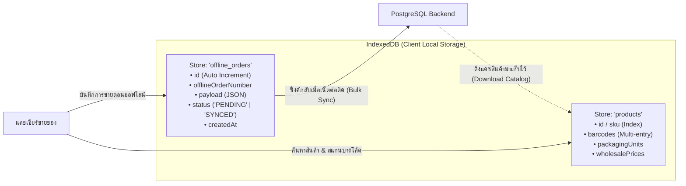
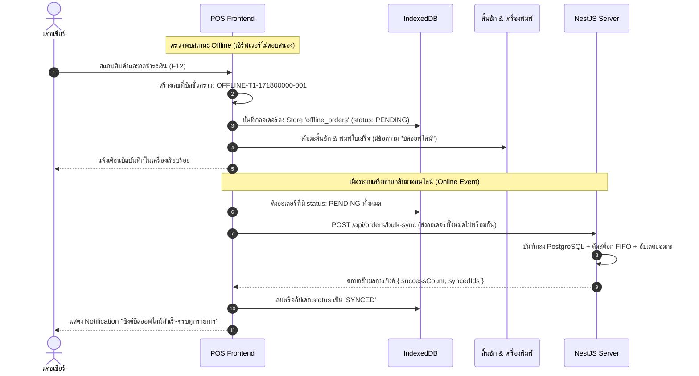

# 07 — การทำงานออฟไลน์และความสมบูรณ์ของข้อมูล (Offline Sync & Data Integrity)

> เอกสารนี้อธิบายกลยุทธ์ Offline-First Architecture, โครงสร้าง IndexedDB, กลไก Outbox Queue และกฎเกณฑ์การรักษาความถูกต้องของข้อมูล (Data Integrity) ในร้านค้าปลีก

---

## 1. ปัญหาของร้านค้าหน้าร้าน (The Retail Continuity Problem)

ในสภาพแวดล้อมร้านค้าจริง สัญญาณเครือข่าย Wi-Fi ภายในร้านอาจหลุด ช่างตัดสายไฟ หรือเราเตอร์รีสตาร์ท **แต่แคชเชียร์ไม่สามารถหยุดคิดเงินลูกค้าที่ยืนรอเข้าแถวอยู่ได้**

Purim POS จึงออกแบบให้:
1. แคชเชียร์สามารถ **สแกนสินค้า, คิดเงินสด, เตะลิ้นชัก และพิมพ์ใบเสร็จได้ตามปกติแม้ขณะออฟไลน์ 100%**
2. เมื่อเครือข่ายกลับมาเชื่อมต่อได้ ข้อมูลบิลขายทั้งหมดจะถูกส่งกลับขึ้นไปซิงค์กับ PostgreSQL บนเซิร์ฟเวอร์หลักอัตโนมัติ

---

## 2. โครงสร้าง IndexedDB (`frontend/src/lib/offline-db.ts`)

เบราว์เซอร์หรือ Electron จะเปิดฐานข้อมูล IndexedDB ในเครื่องแคชเชียร์ แบ่งเป็น 2 Store หลัก:

---

## 3. วงจรการขายออฟไลน์และการซิงค์ข้อมูล (Offline & Sync Flow)

---

## 4. กฎเหล็กความสมบูรณ์ของข้อมูล (Data Integrity Rules)

| กฎข้อที่ | รายละเอียดข้อบังคับ |
| :---: | :--- |
| **1** | **PostgreSQL คือความจริงหนึ่งเดียว (Single Source of Truth)**: ข้อมูลประวัติการขาย, กะ, ลูกหนี้, และสต็อกต้องยึดตาม PostgreSQL เท่านั้น ห้ามถือว่าข้อมูลในเครื่องลูกคือข้อสรุปสุดท้ายจนกว่าจะซิงค์สำเร็จ |
| **2** | **ห้ามใช้ `localStorage` สำหรับประวัติทางธุรกิจ**: ห้ามบันทึกออเดอร์ที่ขายแล้ว หรือประวัติกะลงใน `localStorage` เป็นอันขาด เพราะขนาดจำกัด (5MB) และเสี่ยงต่อการถูกเคลียร์แคชเบราว์เซอร์สูญหายได้ง่าย ให้ใช้ `IndexedDB` สำหรับ Outbox ชั่วคราวเท่านั้น |
| **3** | **ป้องกันการซิงค์บิลซ้ำ (Idempotency Key)**: ออเดอร์ที่ถูกสร้างตอนออฟไลน์จะมี `offlineOrderNumber` กำกับเสมอ หากการเชื่อมต่อหลุดระหว่างที่ส่งข้อมูลไปเซิร์ฟเวอร์ เซิร์ฟเวอร์จะเช็ค `orderNumber` ซ้ำ ถ้ามีแล้วจะไม่สร้างซ้ำและไม่ตัดสต็อกซ้ำซ้อน |
| **4** | **การตัดสต็อกย้อนหลัง (Deferred FIFO)**: บิลออฟไลน์ที่ถูกซิงค์ขึ้นมาจะถูกประมวลผลตัดสต็อก FIFO ตามเวลาที่บันทึกจริง (`createdAt`) เพื่อให้ลำดับเวลาของสินค้าถูกต้อง |
