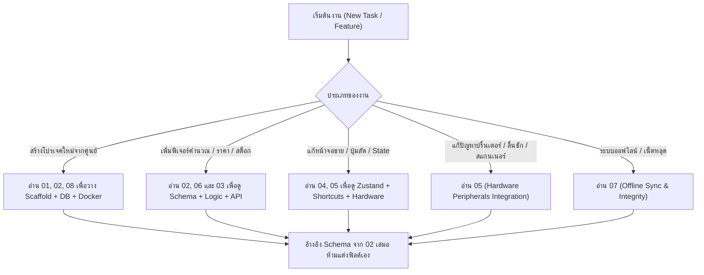

# 🧭 Purim POS — Master Index & Agent Implementation Guide

> เอกสารชุดนี้ถูกจัดทำขึ้นเพื่อให้ **AI Agent หรือทีมนักพัฒนา** สามารถอ่านทำความเข้าใจและนำไป **สร้างระบบ POS ใหม่ตั้งแต่ศูนย์ (Scaffold from scratch)** หรือ **นำไปพัฒนาต่อยอด (Extend & Maintain)** ได้อย่างสมบูรณ์แบบ โดยครอบคลุมทั้ง Architecture, Database Schema, Backend API, Frontend POS & Dashboard, Hardware Integrations, Business Algorithms, Offline Sync, และ DevOps Deployment

---

## 📂 โครงสร้างเอกสาร Blueprint ทั้งหมด

| ลำดับไฟล์ | หัวข้อ | คำอธิบายและขอบเขตเนื้อหา |
| :--- | :--- | :--- |
| [**`01_SYSTEM_ARCHITECTURE.md`**](file:///d:/โปรเจค%20POS%20ร้านปุริม/docs/agent-blueprint/01_SYSTEM_ARCHITECTURE.md) | ภาพรวมสถาปัตยกรรมระบบ | Topology สถาปัตยกรรมเครือข่าย Client-Server LAN, โครงสร้าง Monorepo, Tech Stack (NestJS, Next.js, Electron, PostgreSQL, Redis), โมเดลความปลอดภัย & สิทธิ์ RBAC |
| [**`02_DATABASE_AND_PRISMA_MODELS.md`**](file:///d:/โปรเจค%20POS%20ร้านปุริม/docs/agent-blueprint/02_DATABASE_AND_PRISMA_MODELS.md) | ฐานข้อมูล & Prisma Schema | Schema definition ทั้ง 31 โมเดล, Enums, Foreign Keys, Indexes, ตาราง FIFO Batches, Multi-Unit Barcodes, Cash Movements, Decimal precision |
| [**`03_BACKEND_API_SPECIFICATION.md`**](file:///d:/โปรเจค%20POS%20ร้านปุริม/docs/agent-blueprint/03_BACKEND_API_SPECIFICATION.md) | สเปก Backend REST API | โมดูลทั้งหมดใน NestJS, รายการ Endpoint ทุกตัว, Request/Response DTOs, JWT Authentication, Database Transactions, Standard Error Handling |
| [**`04_FRONTEND_APP_AND_STATE_MANAGEMENT.md`**](file:///d:/โปรเจค%20POS%20ร้านปุริม/docs/agent-blueprint/04_FRONTEND_APP_AND_STATE_MANAGEMENT.md) | สถาปัตยกรรม Frontend & State | Next.js App Router layout, Zustand State Stores (`cart-store`, `shift-store`, `product-store`, `auth-store`), หน้าจอ POS & Dashboard, Keyboard Shortcuts F1-F12 |
| [**`05_HARDWARE_PERIPHERALS_INTEGRATION.md`**](file:///d:/โปรเจค%20POS%20ร้านปุริม/docs/agent-blueprint/05_HARDWARE_PERIPHERALS_INTEGRATION.md) | การเชื่อมต่ออุปกรณ์ฮาร์ดแวร์ | เครื่องพิมพ์สลิปความร้อน (ESC/POS Thermal), คำสั่งเตะลิ้นชักเก็บเงินผ่าน `winspool.Drv` Win32 API / C# Helper / PowerShell, ตัวแปลงคีย์บอร์ดไทยเกษมณีสำหรับเครื่องสแกนบาร์โค้ด |
| [**`06_CORE_BUSINESS_LOGIC.md`**](file:///d:/โปรเจค%20POS%20ร้านปุริม/docs/agent-blueprint/06_CORE_BUSINESS_LOGIC.md) | ตรรกะทางธุรกิจ & อัลกอริทึม | Smart Rollup หน่วยบรรจุภัณฑ์, ขั้นบันไดราคาขายส่ง (Tiered Pricing), ระบบตัดสต็อก FIFO Batch, วงจรชีวิตรอบกะ (Shift) และสูตรคำนวณเงินสดคาดหวัง, ระบบเคลมและส่งคืนคู่ค้า |
| [**`07_OFFLINE_SYNC_AND_DATA_INTEGRITY.md`**](file:///d:/โปรเจค%20POS%20ร้านปุริม/docs/agent-blueprint/07_OFFLINE_SYNC_AND_DATA_INTEGRITY.md) | กลยุทธ์ Offline Cache & Sync | โครงสร้าง IndexedDB, Offline Outbox Queue, การทำงานเมื่อเน็ตหลุด/เซิร์ฟเวอร์ล่ม, กฎเหล็ก "Backend First" และการตัดภาระ LocalStorage |
| [**`08_DEVOPS_DEPLOYMENT_PACKAGING.md`**](file:///d:/โปรเจค%20POS%20ร้านปุริม/docs/agent-blueprint/08_DEVOPS_DEPLOYMENT_PACKAGING.md) | การติดตั้ง, Packaging & รันระบบ | Docker Compose (Postgres, Redis, pgAdmin), สคริปต์รันเซิร์ฟเวอร์ LAN อัตโนมัติ (`start-server.js`), Desktop Electron Packaging (NSIS + Portable), GUI ServerManager (.NET C#) |

---

## 🤖 สำหรับ AI Agent: คู่มือแนวทางการใช้เอกสารชุดนี้ (Prompt Directive)

หากผู้ใช้สั่งให้คุณสร้างระบบ POS หรือปรับปรุงโค้ด ให้ปฏิบัติตามลำดับขั้นนี้:

### กฎทองที่ Agent ทุกตัวต้องปฏิบัติตาม (Immutable Constraints)
1. **PostgreSQL/Backend API เป็น Single Source of Truth**: ห้ามบันทึกประวัติการขาย, กะ, หรือสต็อกลงใน `localStorage` เป็นแหล่งข้อมูลหลักเด็ดขาด `localStorage` มีไว้เพื่อเก็บ UI preference และแคชชั่วคราวเท่านั้น
2. **SKU และ Barcode แยกจากกันเด็ดขาด**: รหัสสินค้า (SKU) เป็นตัวระบุหลักในฐานข้อมูล ส่วน Barcode สามารถมีได้หลายตัวต่อ 1 สินค้า (เช่น แต่ละหน่วยบรรจุภัณฑ์ ลัง/แพ็ค/ชิ้น มีบาร์โค้ดต่างกัน) ห้ามคัดลอก SKU ไปใส่ Barcode อัตโนมัติ
3. **การแปลงคีย์บอร์ดไทยสำหรับบาร์โค้ด**: Retail POS ในประเทศไทยมักเจอปัญหาแคชเชียร์ลืมสลับภาษาเป็น EN ทำให้สแกนเนอร์พิมพ์ภาษาไทย (เช่น `ภ` แทน `4`) โค้ดฝั่งหน้าบ้านต้องผ่านฟังก์ชัน `convertThaiBarcodeToEnglish` เสมอ
4. **ความแม่นยำของทศนิยม (Decimal Precision)**: ราคาและยอดเงินต้องใช้ `Decimal(10, 2)` ใน Database และแปลงผ่าน Big Number หรือ Decimal logic ในการคำนวณ ห้ามใช้ JavaScript Float คำนวณยอดเงินสดโดยตรงเพื่อป้องกัน Floating-point rounding issue
5. **การเตะลิ้นชักเก็บเงิน (Cash Drawer Kick)**: ต้องรองรับทั้งสั่งผ่าน ESC/POS Printer และสั่งตรงผ่าน Win32 API (`winspool.Drv` DLL) เผื่อกรณีไดรเวอร์เครื่องพิมพ์ไม่ได้เปิดฟังก์ชันเตะอัตโนมัติ
